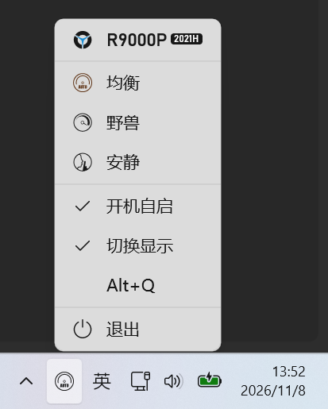

# LegionFanModeTool

联想拯救者散热模式切换工具。没有主界面，只有一个托盘图标。



## 下载

[Releases](https://github.com/YY404NF/LegionFanModeTool/releases)

## 使用

- **左键单击托盘图标**：按 `安静` → `均衡` → `野兽` 循环切换（野兽模式仅在插入电源时生效）
- **开机自启**：默认启用
- **切换显示**：默认启用，切换后在屏幕上显示与 Fn+Q 相同的模式提示
- **Alt+Q**：默认禁用，全局快捷键，可在右键菜单中启用

## 运行要求

- 管理员权限（启动时会弹出 UAC）
- 支持 `LENOVO_GAMEZONE_DATA` WMI 接口的联想拯救者机型
- 已经测试通过的机型：
  - R9000P 2021

## 构建

```bash
dotnet publish LegionFanModeTool.csproj -c Release -o publish
```

## 技术栈

- .NET 11
- WinUI 3（Windows App SDK 2.6）
